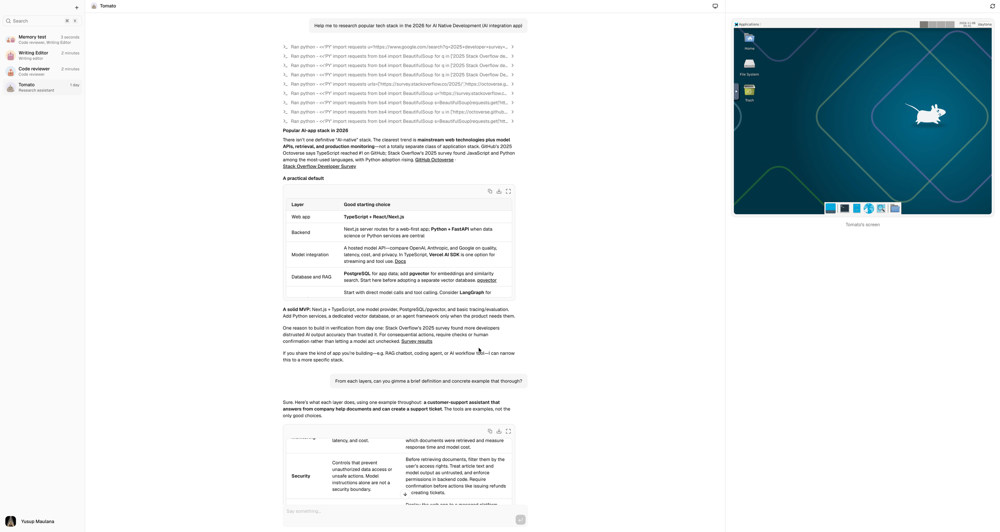
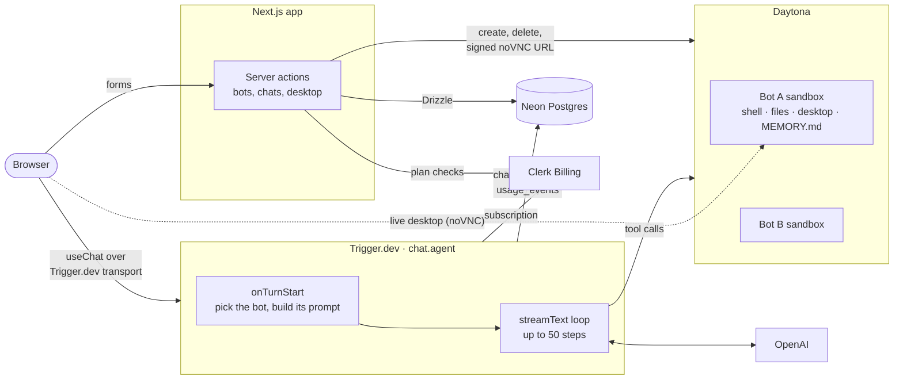

<div align="center">

# Polka

**Create AI bots that each own a real computer, and chat with them alone or as a team.**

Every bot in Polka gets its own cloud sandbox: a private Linux machine with a shell, a filesystem and a desktop it drives with the mouse and keyboard. Give a bot a job, then message it in a direct chat or put several bots in a group chat where they hand work to each other.

[](https://github.com/yusupscopes/polka/actions/workflows/ci.yml)
[](https://nextjs.org)
[](https://react.dev)
[](https://www.typescriptlang.org)
[](https://ai-sdk.dev)
[](https://trigger.dev)
[](https://tailwindcss.com)
[](https://neon.com)
[](https://sentry.io)

[Features](#features) · [How it works](#how-it-works) · [Billing and usage](#billing-and-usage) · [Observability](#observability) · [Tech stack](#tech-stack) · [Getting started](#getting-started) · [Project structure](#project-structure)

</div>

<p align="center">
  
</p>

---

## Features

- **Bots with a job.** Create a bot with a name, a one-line job and optional instructions. Each one gets a generated face (DiceBear) and a direct chat right away.
- **A computer per bot.** Each bot owns an isolated [Daytona](https://www.daytona.io) sandbox, created with the bot and deleted with it. Bots run shell commands, read and write files, and use a 1024×768 desktop through screenshot, click, drag, scroll and type tools.
- **Watch the desktop live.** Open the bot's desktop beside the chat in a resizable panel, or full screen, streamed over a signed, short-lived noVNC link.
- **Group chats.** Put two or more bots in a group, pick which one answers each message, and see every reply tagged with the bot that wrote it.
- **Handoffs.** In a group, a bot can pass a message to a teammate whose job fits better. The new bot takes over mid-reply with its own prompt and its own sandbox.
- **Memory across chats.** Each chat only sees its own messages. A per-bot `MEMORY.md` in the sandbox carries what the bot learns between its direct chat and every group it's in.
- **Durable streaming.** Replies run as a [Trigger.dev](https://trigger.dev) `chat.agent`, so long multi-step tool runs (up to 50 steps) survive refreshes and keep streaming to the browser.
- **A polished chat UI.** Streaming Markdown with code, math and Mermaid, tool call cards, a collapsible sidebar, and ⌘K chat search, built on shadcn/ui and AI Elements.
- **Pro plan with a monthly allowance.** Bots, chats and desktops are part of a Pro plan sold through [Clerk Billing](https://clerk.com/docs/billing/overview). Each billing period includes $5 of model usage and 30 hours of sandbox time (an annual plan gets 12 times that). A `/usage` page shows how much of each is used and when it resets.
- **Error and log monitoring.** The app and the agent both report to one [Sentry](https://sentry.io) project: errors, traces, session replays, failed Trigger.dev runs, and structured logs for each chat turn.

## How it works



1. **Creating a bot** provisions a Daytona sandbox first, seeds an empty memory file, then writes the bot, its direct chat and the membership in one database transaction. If any step fails, the sandbox is cleaned up so nothing is left orphaned.
2. **Sending a message** starts or resumes a Trigger.dev session keyed by the chat id. At the start of each turn, the agent loads the chat and its members, checks that the requested bot belongs to the chat, checks the user's subscription and remaining AI allowance, and sets that bot's system prompt and sandbox for the turn.
3. **Tools** look the sandbox up on every call and start it, and its desktop, if Daytona has auto-stopped them, so an idle chat never holds a stale handle. Each use also charges the bot's sandbox time to the usage ledger. Screenshots are passed back to the model as images, not base64 text.
4. **Handoffs** switch the turn-local bot and sandbox, and `prepareStep` swaps in the new bot's prompt for the remaining steps. The handoff tool is then removed, so a message can only be passed on once.

## Billing and usage

Polka checks two Clerk Billing features, `bots` and `sandboxes`, with `has({ feature })`. The Pro plan has both and the free plan has neither. A free account can't create a bot, send a message or open a desktop. Each blocked action shows a toast that links to `/pricing`, which renders Clerk's `PricingTable`.

Usage is stored in `usage_events`, a ledger that only ever gains rows. A period's usage is the sum of its rows. Bots and chats aren't foreign keys there, so deleting a bot doesn't erase what it used.

| Meter | Recorded when | Cost basis |
| --- | --- | --- |
| `ai` | After each model step | OpenAI token prices for the model in [`lib/billing.ts`](lib/billing.ts), with a lower rate for cached input |
| `sandbox` | Whenever a bot uses its sandbox: a tool call, the desktop viewer's heartbeat, or bot creation | Daytona's per-second price, billed ahead up to the 15-minute auto-stop |

- **Period:** the current period of the user's Clerk subscription, so usage resets when Clerk renews it.
- **AI limit:** a turn is refused if no AI allowance is left. A turn that runs out mid-reply stops after its current step.
- **Sandbox limit:** tools fail once sandbox time is used up. Because sandbox time is billed ahead, usage can go over the limit by at most one auto-stop interval.

To change the allowance or prices, edit `MONTHLY_ALLOWANCE`, `MODEL_PRICE` and `SANDBOX_PRICE_NANOS_PER_SECOND` in [`lib/billing.ts`](lib/billing.ts).

## Observability

| Where | What reaches Sentry |
| --- | --- |
| Browser | Errors, 10% of traces, and session replays (10% of sessions, plus every session with an error). Events go through the app at `/monitoring`, so ad blockers don't drop them |
| Next.js server and edge | Errors, 10% of traces (all of them in development), console warnings and errors |
| Trigger.dev worker ([`trigger/init.ts`](trigger/init.ts)) | Runs that failed after their last retry, tagged with task, run and attempt. Errors and logs only, because Trigger.dev already handles OpenTelemetry. Logs are flushed before a run pauses or ends |

Structured logs cover the life of bots, sandboxes, desktops and group chats, refused turns and sandbox charges, failed tool calls, and one event per chat turn with the bot that answered, its token count and its cost.

Source maps are uploaded when `SENTRY_AUTH_TOKEN` is set, by `next build` and by `trigger.dev deploy`. To use your own Sentry project, change `org` and `project` in [`next.config.ts`](next.config.ts) and [`trigger.config.ts`](trigger.config.ts).

## Tech stack

| Layer | Tools |
| --- | --- |
| Framework | [Next.js 16](https://nextjs.org) (App Router, Server Actions), [React 19](https://react.dev), TypeScript |
| AI | [AI SDK v7](https://ai-sdk.dev) with OpenAI, [Trigger.dev](https://trigger.dev) `chat.agent` for durable, resumable runs |
| Sandboxes | [Daytona](https://www.daytona.io): process, filesystem and computer-use APIs, plus noVNC previews |
| Data | [Neon](https://neon.com) Postgres, [Drizzle ORM](https://orm.drizzle.team), `drizzle-zod` |
| Auth | [Clerk](https://clerk.com) |
| Billing | [Clerk Billing](https://clerk.com/docs/billing/overview) |
| Monitoring | [Sentry](https://sentry.io) |
| UI | [shadcn/ui](https://ui.shadcn.com) on [Base UI](https://base-ui.com), [AI Elements](https://ai-sdk.dev/elements), Tailwind CSS 4, [Streamdown](https://streamdown.ai), [DiceBear](https://www.dicebear.com) |
| Forms | React Hook Form, Zod 4 |
| Hosting | [Railway](https://railway.com) (app), Trigger.dev Cloud (agent) |

## Getting started

### Prerequisites

- Node.js 24 or later
- Accounts on [Clerk](https://clerk.com), [Neon](https://neon.com), [OpenAI](https://platform.openai.com), [Trigger.dev](https://trigger.dev), [Daytona](https://www.daytona.io) and [Sentry](https://sentry.io)
- A Clerk Billing plan that includes the `bots` and `sandboxes` features

### 1. Clone and install

```bash
git clone https://github.com/yusupscopes/polka.git
cd polka
npm install
```

### 2. Configure environment variables

```bash
cp .env.example .env.local
```

| Variable | Where to get it |
| --- | --- |
| `NEXT_PUBLIC_CLERK_PUBLISHABLE_KEY`, `CLERK_SECRET_KEY` | Clerk dashboard, or `clerk env pull` |
| `DATABASE_URL` | Neon pooled connection string, used by the app |
| `DATABASE_URL_UNPOOLED` | Neon direct connection string, used by `npm run db:push` |
| `OPENAI_API_KEY` | OpenAI dashboard |
| `TRIGGER_SECRET_KEY` | Trigger.dev dashboard, API keys (`tr_dev_...` for local development) |
| `DAYTONA_API_KEY`, `DAYTONA_API_URL` | Daytona dashboard |
| `NEXT_PUBLIC_SENTRY_DSN` | Sentry project settings, Client Keys (DSN) |
| `SENTRY_AUTH_TOKEN` | Sentry settings, Auth Tokens. Only needed at build time, for source maps |

The Clerk route variables in `.env.example` are already filled in.

### 3. Set up the database

```bash
npm run db:push
```

This pushes the schema in [`lib/db/schema.ts`](lib/db/schema.ts) straight to your Neon database, including the `usage_events` ledger.

### 4. Run it

The app and the agent run as two processes. Start both:

```bash
# Terminal 1: the Next.js app on http://localhost:3000
npm run dev

# Terminal 2: the Trigger.dev agent
npx trigger.dev@4.8.5 dev
```

Before running the agent against your own Trigger.dev account, set `project` in [`trigger.config.ts`](trigger.config.ts) to your project ref.

Sign up, subscribe to Pro at `/pricing` (a Clerk test card works in development), then create your first bot and say hello.

## Scripts

| Command | Description |
| --- | --- |
| `npm run dev` | Start the Next.js dev server |
| `npm run build` | Build for production |
| `npm run start` | Serve the production build |
| `npm run lint` | Lint with ESLint |
| `npm run typecheck` | Generate Next.js route types, then type-check with `tsc` |
| `npm test` | Run the unit tests with Vitest |
| `npm run format` | Format with Prettier |
| `npm run db:push` | Push the Drizzle schema to the database |
| `npm run db:studio` | Open Drizzle Studio |

## Tests and CI

Unit tests use [Vitest](https://vitest.dev) and sit next to the code they test, as `*.test.ts`. They cover the form schemas and the usage pricing, and need no database, network or secrets.

[GitHub Actions](.github/workflows/ci.yml) runs `npm run lint`, `npm run typecheck` and `npm test` on every push to `main` and every pull request.

## Project structure

```
polka/
├── actions/             # Server actions: bots, chats, desktop URLs
├── app/
│   ├── (dashboard)/     # Signed-in app: bot list and chat pages
│   │   ├── pricing/     # Clerk PricingTable
│   │   └── usage/       # AI and sandbox usage for the current period
│   ├── sign-in/         # Clerk sign-in
│   └── sign-up/         # Clerk sign-up
├── components/
│   ├── ai-elements/     # Chat primitives: messages, tools, prompt input
│   ├── ui/              # shadcn/ui components
│   ├── chat.tsx         # Chat view, bot picker and handoff rendering
│   └── desktop-panel.tsx  # Live sandbox desktop beside the chat
├── lib/
│   ├── db/              # Drizzle client and schema
│   ├── billing.ts       # Plan features, allowance and prices
│   ├── usage.ts         # Usage ledger, subscription periods, sandbox charges
│   └── daytona.ts       # Daytona client
├── queries/             # Server-only data access
├── trigger/
│   ├── chat.ts          # chat.agent: turn setup, prompts, handoffs
│   ├── init.ts          # Sentry for the worker, failed run reporting
│   └── tools.ts         # Sandbox, desktop and handoff tools
├── instrumentation*.ts  # Sentry for the browser and Next.js runtimes
├── sentry.*.config.ts   # Sentry server and edge config
└── trigger.config.ts
```

## Deployment

- **App:** deployed on Railway. Copy the variables from `.env.local` to the service, except `TRIGGER_SECRET_KEY`, which must be the production key (`tr_prod_...`) from the Trigger.dev dashboard. `SENTRY_AUTH_TOKEN` must be available at build time so source maps are uploaded.
- **Agent:** deploy the tasks in `trigger/` with `npx trigger.dev@4.8.5 deploy`, and set the same OpenAI, Neon and Daytona variables in the Trigger.dev production environment. The worker also needs `CLERK_SECRET_KEY` to read subscriptions, `NEXT_PUBLIC_SENTRY_DSN` to report to Sentry, and `SENTRY_AUTH_TOKEN` at deploy time for source maps.

## Security notes

- Every server action starts with `auth.protect()` and takes the user id only from Clerk, and every query is scoped to that user.
- Input is validated on the server with the same Zod schemas the forms use.
- The bot id sent with each message is checked against the chat's members before the agent runs.
- Desktop links are signed and expire after an hour.
- Each bot runs in its own sandbox, so one bot can't reach another bot's files or desktop.
- Plan features and allowances are checked on the server, in the server action and again in the agent, so a modified client can't skip them.
- The agent reads subscriptions with Clerk's backend client and the secret key, never from the browser.

## Acknowledgements

Built with [Next.js](https://nextjs.org), [AI SDK](https://ai-sdk.dev), [Trigger.dev](https://trigger.dev), [Daytona](https://www.daytona.io), [Neon](https://neon.com), [Clerk](https://clerk.com), [Sentry](https://sentry.io), [shadcn/ui](https://ui.shadcn.com) and [DiceBear](https://www.dicebear.com).

<div align="center">

Made by [Yusup Maulana](https://github.com/yusupscopes)

</div>
