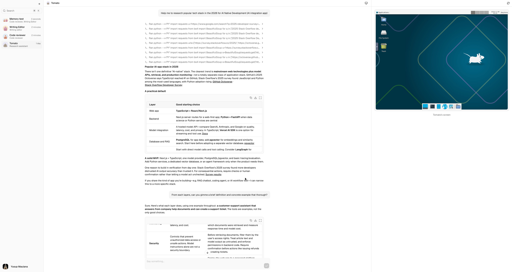
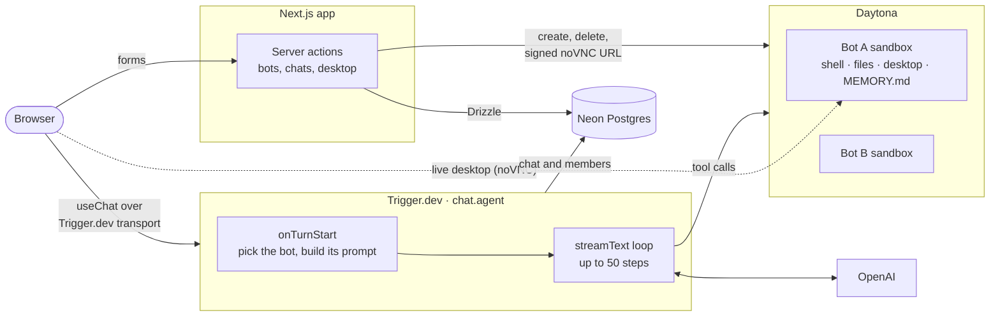

<div align="center">

# Polka

**Create AI bots that each own a real computer, and chat with them alone or as a team.**

Every bot in Polka gets its own cloud sandbox: a private Linux machine with a shell, a filesystem and a desktop it drives with the mouse and keyboard. Give a bot a job, then message it in a direct chat or put several bots in a group chat where they hand work to each other.

[](https://nextjs.org)
[](https://react.dev)
[](https://www.typescriptlang.org)
[](https://ai-sdk.dev)
[](https://trigger.dev)
[](https://tailwindcss.com)
[](https://neon.com)

[Features](#features) · [How it works](#how-it-works) · [Tech stack](#tech-stack) · [Getting started](#getting-started) · [Project structure](#project-structure)

</div>

<p align="center">
  
</p>

---

## Features

- **Bots with a job.** Create a bot with a name, a one-line job and optional instructions. Each one gets a generated face (DiceBear) and a direct chat right away.
- **A computer per bot.** Each bot owns an isolated [Daytona](https://www.daytona.io) sandbox, created with the bot and deleted with it. Bots run shell commands, read and write files, and use a 1024×768 desktop through screenshot, click, drag, scroll and type tools.
- **Watch the desktop live.** Open the bot's desktop beside the chat in a resizable panel, or full screen, streamed over a signed, short-lived noVNC link.
- **Group chats.** Put two or more bots in a group, pick which one answers each message, and see every reply tagged with the bot that wrote it.
- **Handoffs.** In a group, a bot can pass a message to a teammate whose job fits better. The new bot takes over mid-reply with its own prompt and its own sandbox.
- **Memory across chats.** Each chat only sees its own messages. A per-bot `MEMORY.md` in the sandbox carries what the bot learns between its direct chat and every group it's in.
- **Durable streaming.** Replies run as a [Trigger.dev](https://trigger.dev) `chat.agent`, so long multi-step tool runs (up to 50 steps) survive refreshes and keep streaming to the browser.
- **A polished chat UI.** Streaming Markdown with code, math and Mermaid, tool call cards, a collapsible sidebar, and ⌘K chat search, built on shadcn/ui and AI Elements.

## How it works



1. **Creating a bot** provisions a Daytona sandbox first, seeds an empty memory file, then writes the bot, its direct chat and the membership in one database transaction. If any step fails, the sandbox is cleaned up so nothing is left orphaned.
2. **Sending a message** starts or resumes a Trigger.dev session keyed by the chat id. At the start of each turn, the agent loads the chat and its members, checks that the requested bot belongs to the chat, and sets that bot's system prompt and sandbox for the turn.
3. **Tools** look the sandbox up on every call and start it, and its desktop, if Daytona has auto-stopped them, so an idle chat never holds a stale handle. Screenshots are passed back to the model as images, not base64 text.
4. **Handoffs** switch the turn-local bot and sandbox, and `prepareStep` swaps in the new bot's prompt for the remaining steps. The handoff tool is then removed, so a message can only be passed on once.

## Tech stack

| Layer | Tools |
| --- | --- |
| Framework | [Next.js 16](https://nextjs.org) (App Router, Server Actions), [React 19](https://react.dev), TypeScript |
| AI | [AI SDK v7](https://ai-sdk.dev) with OpenAI, [Trigger.dev](https://trigger.dev) `chat.agent` for durable, resumable runs |
| Sandboxes | [Daytona](https://www.daytona.io): process, filesystem and computer-use APIs, plus noVNC previews |
| Data | [Neon](https://neon.com) Postgres, [Drizzle ORM](https://orm.drizzle.team), `drizzle-zod` |
| Auth | [Clerk](https://clerk.com) |
| UI | [shadcn/ui](https://ui.shadcn.com) on [Base UI](https://base-ui.com), [AI Elements](https://ai-sdk.dev/elements), Tailwind CSS 4, [Streamdown](https://streamdown.ai), [DiceBear](https://www.dicebear.com) |
| Forms | React Hook Form, Zod 4 |
| Hosting | [Railway](https://railway.com) (app), Trigger.dev Cloud (agent) |

## Getting started

### Prerequisites

- Node.js 24 or later
- Accounts on [Clerk](https://clerk.com), [Neon](https://neon.com), [OpenAI](https://platform.openai.com), [Trigger.dev](https://trigger.dev) and [Daytona](https://www.daytona.io)

### 1. Clone and install

```bash
git clone https://github.com/yusupscopes/polka.git
cd polka
npm install
```

### 2. Configure environment variables

```bash
cp .env.example .env.local
```

| Variable | Where to get it |
| --- | --- |
| `NEXT_PUBLIC_CLERK_PUBLISHABLE_KEY`, `CLERK_SECRET_KEY` | Clerk dashboard, or `clerk env pull` |
| `DATABASE_URL` | Neon pooled connection string, used by the app |
| `DATABASE_URL_UNPOOLED` | Neon direct connection string, used by `npm run db:push` |
| `OPENAI_API_KEY` | OpenAI dashboard |
| `TRIGGER_SECRET_KEY` | Trigger.dev dashboard, API keys (`tr_dev_...` for local development) |
| `DAYTONA_API_KEY`, `DAYTONA_API_URL` | Daytona dashboard |

The Clerk route variables in `.env.example` are already filled in.

### 3. Set up the database

```bash
npm run db:push
```

This pushes the schema in [`lib/db/schema.ts`](lib/db/schema.ts) straight to your Neon database.

### 4. Run it

The app and the agent run as two processes. Start both:

```bash
# Terminal 1: the Next.js app on http://localhost:3000
npm run dev

# Terminal 2: the Trigger.dev agent
npx trigger.dev@4.8.3 dev
```

Before running the agent against your own Trigger.dev account, set `project` in [`trigger.config.ts`](trigger.config.ts) to your project ref.

Sign up, create your first bot, and say hello.

## Scripts

| Command | Description |
| --- | --- |
| `npm run dev` | Start the Next.js dev server |
| `npm run build` | Build for production |
| `npm run start` | Serve the production build |
| `npm run lint` | Lint with ESLint |
| `npm run typecheck` | Type-check with `tsc` |
| `npm run format` | Format with Prettier |
| `npm run db:push` | Push the Drizzle schema to the database |
| `npm run db:studio` | Open Drizzle Studio |

## Project structure

```
polka/
├── actions/             # Server actions: bots, chats, desktop URLs
├── app/
│   ├── (dashboard)/     # Signed-in app: bot list and chat pages
│   ├── sign-in/         # Clerk sign-in
│   └── sign-up/         # Clerk sign-up
├── components/
│   ├── ai-elements/     # Chat primitives: messages, tools, prompt input
│   ├── ui/              # shadcn/ui components
│   ├── chat.tsx         # Chat view, bot picker and handoff rendering
│   └── desktop-panel.tsx  # Live sandbox desktop beside the chat
├── lib/
│   ├── db/              # Drizzle client and schema
│   └── daytona.ts       # Daytona client
├── queries/             # Server-only data access
├── trigger/
│   ├── chat.ts          # chat.agent: turn setup, prompts, handoffs
│   └── tools.ts         # Sandbox, desktop and handoff tools
└── trigger.config.ts
```

## Deployment

- **App:** deployed on Railway. Copy the variables from `.env.local` to the service, except `TRIGGER_SECRET_KEY`, which must be the production key (`tr_prod_...`) from the Trigger.dev dashboard.
- **Agent:** deploy the tasks in `trigger/` with `npx trigger.dev@4.8.3 deploy`, and set the same OpenAI, Neon and Daytona variables in the Trigger.dev production environment.

## Security notes

- Every server action starts with `auth.protect()` and takes the user id only from Clerk, and every query is scoped to that user.
- Input is validated on the server with the same Zod schemas the forms use.
- The bot id sent with each message is checked against the chat's members before the agent runs.
- Desktop links are signed and expire after an hour.
- Each bot runs in its own sandbox, so one bot can't reach another bot's files or desktop.

## Acknowledgements

Built with [Next.js](https://nextjs.org), [AI SDK](https://ai-sdk.dev), [Trigger.dev](https://trigger.dev), [Daytona](https://www.daytona.io), [Neon](https://neon.com), [Clerk](https://clerk.com), [shadcn/ui](https://ui.shadcn.com) and [DiceBear](https://www.dicebear.com).

<div align="center">

Made by [Yusup Maulana](https://github.com/yusupscopes)

</div>
